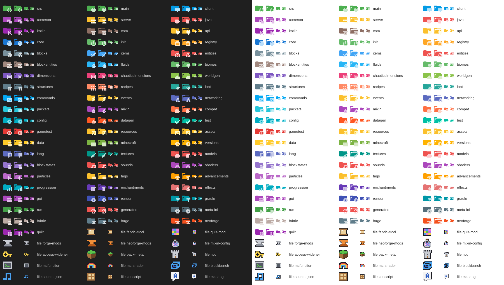

# Minecraft Material Icons

A VS Code icon theme for **Minecraft mod development** that combines:

1. **Custom Minecraft icons** in the minimalist Material style (a single-color folder with a pixel-art symbol in a lighter tint of the same color) for the folders and files you find in Fabric, Forge, NeoForge and Quilt mods, written in Java or Kotlin;
2. **General icons derived from the [Material Icon Theme](https://github.com/material-extensions/vscode-material-icon-theme)** (MIT license) for everything else: JavaScript, TypeScript, Java, Python, JSON, YAML, XML, Markdown, images, fonts, Docker, Git, Gradle, npm, databases, common folders and more.

Every Minecraft folder has a **closed and an open** icon. Like the Material Icon Theme, each icon uses **a single color**: the folder uses Material's folder shape, and the symbol is a solid, monochrome shape in a light tint of that color. Folders that Material already had (`src`, `config`, `test`, `java`, `gradle`...) keep Material's colors; new ones use the same Material Design palette. **Mod files** (`fabric.mod.json`, `*.mixins.json`, `pack.mcmeta`...) get colorful pixel-art icons with a dark outline so they stand out. The same icons work in dark, light and high-contrast themes.

> Unofficial project. Not affiliated with Mojang Studios or Microsoft. No Minecraft textures or assets were copied: the icons are conceptual (portal, block, gear, world, database, sword, network, code...).



## Installation

**From the Marketplace:** search for **Minecraft Material Icons** in the VS Code *Extensions* view, or run `ext install hadrykkxd.minecraft-material-icons` from Quick Open (`Ctrl+P`).

**From a .vsix file:** open the *Extensions* view (`Ctrl+Shift+X`), click `...` (top right), choose **Install from VSIX...** and select `minecraft-material-icons-1.1.2.vsix`.

**From the terminal:**

```bash
code --install-extension "minecraft-material-icons-1.1.2.vsix"
```

**Enable the theme:** `Ctrl+Shift+P` → **Preferences: File Icon Theme** → **Minecraft Material Icons**.

There are two options in the picker:
- **Minecraft Material Icons**: with the expand/collapse arrows (›/⌄) next to folders.
- **Minecraft Material Icons (No Arrows)**: hides the Explorer arrows. The open/closed folder icon shows the state.

**Hiding the vertical tree lines:** they are a VS Code setting, not part of the theme. Open `Ctrl+Shift+P` → **Preferences: Open User Settings (JSON)** and add:

```json
"workbench.tree.renderIndentGuides": "none"
```

The extension is standalone: it **does not modify** your Material Icon Theme installation. Both can be installed side by side; whichever you pick in *File Icon Theme* is used.

## Priority rules

When a name has more than one association, this order applies:

1. Specific **Minecraft folder** association (`folderNames`, `folderNamesExpanded`, `rootFolderNames`, `rootFolderNamesExpanded`)
2. Specific **Minecraft file** association (mod `fileNames` and `fileExtensions`)
3. General **Material Icon Theme** association
4. **Generic** icon (Material's default file/folder)

General extensions keep the Material icon: `.java`, `.json`, `.js`, `.ts`, `.py`, `.md`, `.yml`, `.yaml`, `.xml`, `.toml`, `.gradle`, `.properties`, `.png`, `.jpg`, `.svg`, `.gif`, `.wav` and `.ogg`.

Mod files with a Minecraft icon: `fabric.mod.json`, `quilt.mod.json`, `mods.toml`, `neoforge.mods.toml`, `*.mixins.json`, `*.accesswidener`, `accesstransformer.cfg`, `pack.mcmeta`, `pack.png`, `*.mcmeta`, `*.nbt`, `*.snbt`, `*.schem`, `*.litematic`, `*.mcfunction`, `*.fsh`, `*.vsh`, `*.bbmodel`, `sounds.json`, `*.zs`, `*.lang` and language files (`en_us.json`, `pt_br.json`...).

VS Code matches names case-insensitively: `META-INF` and `meta-inf` use the same icon.

<!-- FOLDERS:START -->
## Folders: found and predicted

Last scan: project `chaoticdimensions` (2026-11-11): Minecraft 1.20.1, Fabric, 134 Java / 0 Kotlin files.

Project-specific names: `registry`, `chaoticdimensions`, `worldgen`, `mixin`, `compat`, `versions`, `progression`.

| Category | Folder names | Origin | Status |
|---|---|---|---|
| src | `src` | conventional | ✅ found |
| main | `main` | conventional | ✅ found |
| client | `client` | conventional | ✅ found |
| common | `common` | conventional | 🔮 predicted |
| server | `server` `dedicatedserver` | conventional | 🔮 predicted |
| java | `java` | conventional | ✅ found |
| kotlin | `kotlin` | conventional | 🔮 predicted |
| com | `com` `net` `org` `blue` | conventional | ✅ found |
| api | `api` | conventional | 🔮 predicted |
| core | `core` `gameplay` | conventional | ✅ found |
| init | `init` | conventional | 🔮 predicted |
| registry | `registry` `registries` | project | ✅ found |
| blocks | `blocks` `block` | conventional | ✅ found |
| items | `items` `item` `armor` `ingots` | conventional | ✅ found |
| entities | `entities` `entity` `mobs` `mob` `entity_types` | conventional | ✅ found |
| blockentities | `blockentities` `blockentity` `block_entity` `block_entities` `tileentities` `tileentity` | conventional | 🔮 predicted |
| fluids | `fluids` `fluid` `water` | conventional | ✅ found |
| biomes | `biomes` `biome` `tree` `trees` | conventional | ✅ found |
| dimensions | `dimensions` `dimension` `dimension_type` `dimension_types` `aurora` `shadow` | conventional | ✅ found |
| chaoticdimensions | `chaoticdimensions` `chaotic_dimensions` `chaotic-dimensions` `chaoticd` | project | ✅ found |
| worldgen | `worldgen` `configured_feature` `placed_feature` `noise_settings` `density_function` `carver` `carvers` `noise` | project | ✅ found |
| structures | `structures` `structure` `template_pool` `processor_list` `structure_set` `dream_fluid_cavern` `dream_fluid_island` `dream_fluid_sky_lake` | conventional | ✅ found |
| recipes | `recipes` `recipe` `crafting` | conventional | ✅ found |
| loot | `loot` `loot_tables` `loot_table` `loottables` `loot_modifiers` `trade` `trades` | conventional | ✅ found |
| commands | `commands` `command` | conventional | ✅ found |
| events | `events` `event` | conventional | 🔮 predicted |
| networking | `networking` `network` `netcode` | conventional | ✅ found |
| packets | `packets` `packet` | conventional | 🔮 predicted |
| mixin | `mixin` `mixins` `accessor` `accessors` `injection` | project | ✅ found |
| compat | `compat` `compatibility` `jei` `rei` `emi` | project | 🔮 predicted |
| config | `config` `configs` | conventional | 🔮 predicted |
| datagen | `datagen` `data_gen` | conventional | 🔮 predicted |
| test | `test` `tests` | conventional | ✅ found |
| gametest | `gametest` `gametests` `game_test` | conventional | 🔮 predicted |
| resources | `resources` `resource` `orespawn` `ores` | conventional | ✅ found |
| assets | `assets` | conventional | ✅ found |
| data | `data` | conventional | ✅ found |
| minecraft | `minecraft` | conventional | ✅ found |
| versions | `versions` `version` `mc-versions` `1.7.10` `1.8.9` `1.12.2` … (+20, see docs/FOLDERS.md) | project | ✅ found |
| lang | `lang` `langs` | conventional | ✅ found |
| textures | `textures` `texture` | conventional | ✅ found |
| models | `models` `geo` | conventional | ✅ found |
| blockstates | `blockstates` `blockstate` | conventional | ✅ found |
| sounds | `sounds` `sound` | conventional | 🔮 predicted |
| shaders | `shaders` `shader` `post_effect` | conventional | 🔮 predicted |
| particles | `particles` `particle` | conventional | 🔮 predicted |
| tags | `tags` `tag` `mineable` `c` | conventional | ✅ found |
| advancements | `advancements` `advancement` `achievements` | conventional | ✅ found |
| progression | `progression` | project | ✅ found |
| enchantments | `enchantments` `enchantment` `enchant` | conventional | ✅ found |
| effects | `effects` `effect` `potions` `potion` `mob_effect` `mob_effects` | conventional | ✅ found |
| gui | `gui` `screen` `screens` `menu` | conventional | ✅ found |
| render | `render` `renderer` `renderers` `rendering` `visual` | conventional | ✅ found |
| gradle | `gradle` `buildsrc` `buildlogic` `build-logic` `wrapper` | conventional | ✅ found |
| run | `run` `runs` `run-client` `run-server` `rundata` | conventional | 🔮 predicted |
| generated | `generated` | conventional | 🔮 predicted |
| meta-inf | `meta-inf` | conventional | 🔮 predicted |
| fabric | `fabric` `fabric-1.7.10` `fabric-1.8.9` `fabric-1.12.2` `fabric-1.16.5` `fabric-1.18.2` … (+18, see docs/FOLDERS.md) | conventional | ✅ found |
| forge | `forge` `forge-1.7.10` `forge-1.8.9` `forge-1.12.2` `forge-1.16.5` `forge-1.18.2` … (+18, see docs/FOLDERS.md) | conventional | ✅ found |
| neoforge | `neoforge` `neoforged` `neoforge-1.7.10` `neoforge-1.8.9` `neoforge-1.12.2` `neoforge-1.16.5` … (+19, see docs/FOLDERS.md) | conventional | ✅ found |
| quilt | `quilt` `quilt-1.7.10` `quilt-1.8.9` `quilt-1.12.2` `quilt-1.16.5` `quilt-1.18.2` … (+18, see docs/FOLDERS.md) | conventional | ✅ found |
<!-- FOLDERS:END -->

## Development

Requirements: Node.js 18 or later.

```bash
npm install        # installs vsce, the official Material Icon Theme (npm, MIT) and helpers
npm run package    # generates icons, merges the theme, validates and creates dist/minecraft-material-icons-<version>.vsix
```

| Script | What it does |
|---|---|
| `npm run icons` | Generates the Minecraft SVGs in `icons/minecraft/` and the `images/icon.png` extension icon |
| `npm run theme` | Merges the Material Icon Theme with the Minecraft icons into `themes/` (with and without arrows) and copies only the Material SVGs that are used |
| `npm run validate` | Validates `package.json`, every JSON file, every SVG, broken references, absolute paths and the priority rules |
| `npm run build` | `icons` + `theme` + `validate` |
| `npm run package` | `build` + `vsce package` + check of the `.vsix` contents |
| `npm run scan -- "<mod folder>"` | Analyzes a mod project (read-only) |
| `npm run add-folder -- ...` | Adds folders and files to the theme |
| `npm run preview` | Generates `images/preview.png` with every Minecraft icon |

### Structure

```
package.json                     extension manifest
themes/                          generated themes (do not edit by hand)
icons/minecraft/                 generated Minecraft SVGs (custom)
icons/material/                  SVGs copied from Material Icon Theme (MIT)
images/icon.png                  extension icon
src/minecraft-icons.json         ← config: categories, colors, folder and file names
src/glyphs.mjs                   ← folder symbols (solid, single-color pixel art)
src/file-glyphs.mjs              ← mod file icons (colorful pixel art + PALETTE)
scripts/                         build, validation, scan, add-folder, .vsix check
licenses/, THIRD_PARTY_NOTICES.md   Material Icon Theme license and credits
```

## Adding new folders later

```bash
npm run add-folder -- --list                              # available categories and glyphs
npm run add-folder -- dims dimensions                     # "dims" uses the portal icon
npm run add-folder -- mymod chaoticdimensions --root      # also when it is the workspace root
npm run add-folder -- quests --new --glyph trophy --color "#8a6a1a"   # new category
npm run add-folder -- --file mymod.mixins.json mixin-config
npm run add-folder -- --ext mcpack pack-meta
npm run package
```

You can also edit `src/minecraft-icons.json` directly. For a new drawing, add a glyph to `src/glyphs.mjs` (folders) or `src/file-glyphs.mjs` (files): a grid of up to 8×8 using `#` (pixel) and `.` (empty) for folders, or `PALETTE` color letters for files. The folder color comes from `color` in `src/minecraft-icons.json`, and the symbol automatically uses a light tint of it (or `glyphColor`, if you set one).

## Scanning your mod project

```bash
npm run scan -- "C:\path\to\your\mod"
npm run package
```

The scan detects the Minecraft version, the loader (Fabric, Forge, NeoForge, Quilt or Architectury), Java and/or Kotlin, the Gradle files, the wrapper, subprojects and source sets, including repositories with several loaders/versions in subfolders. It also lists the folders it found (with a Minecraft icon, with a Material icon or without an icon) and the predicted-only categories. It **never creates or changes folders** in your project. After `npm run package`, the folder table in this README marks the folders that were found.

## Updating the extension

1. Make your changes (`add-folder`, `src/minecraft-icons.json`, `src/glyphs.mjs` or `src/file-glyphs.mjs`).
2. Bump the version: `npm version patch --no-git-tag-version` (or `minor`/`major`).
3. Record the change in `CHANGELOG.md`.
4. Run `npm run package` to build the new `dist/minecraft-material-icons-<version>.vsix`.
5. Publish: on marketplace.visualstudio.com/manage, open the extension's **⋮** menu → **Update** → upload the new `.vsix`. Or install the new `.vsix` the same way as above. The ID stays the same (`hadrykkxd.minecraft-material-icons`), so it replaces the previous version. Reload the window if asked.

**Updating the general Material icons:**

```bash
npm install material-icon-theme@latest --save-dev --save-exact
npm run package
```

The build copies only the required SVGs again, reapplies the Minecraft priority and validates everything.

## Credits and license

- Minecraft icons, scripts and configuration: © hadryphern, MIT. See `LICENSE`. Source code: https://github.com/hadryphern/minecraft-material-icons
- Folder shapes (closed/open) and general icons: [Material Icon Theme](https://github.com/material-extensions/vscode-material-icon-theme) © Material Extensions, MIT license. A copy of the original license is in `licenses/material-icon-theme-LICENSE`, with details in `THIRD_PARTY_NOTICES.md`. The SVGs come unmodified from the official `material-icon-theme` npm package.
- Minecraft is a trademark of Mojang Studios/Microsoft. This extension is not official.
